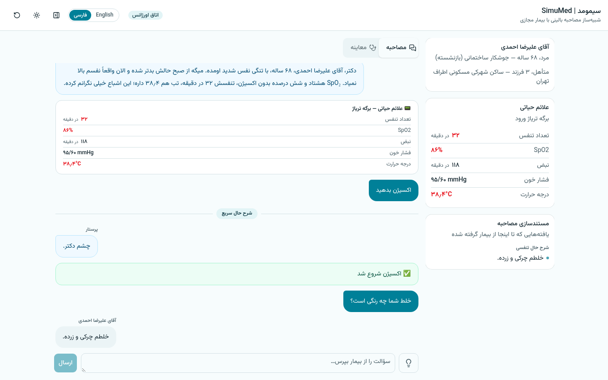

# SimuMed

**SimuMed** is a bilingual emergency-department simulator for medical students.
Interview and examine a virtual patient, order investigations, and review your
decisions in a scored debrief. The same fictional case runs in English and
Persian.

[Try the no-key demo](#try-it-locally).

<details>
<summary>Watch the English demo and see the Persian interface</summary>




</details>

## Try it locally

With Node.js 22, run these commands from the repository root.

```bash
cd app
npm ci
SIMUMED_MOCK_LLM=1 npm run dev
```

Open [localhost:3000](http://localhost:3000), choose English or Persian, and
select **Start**. The demo uses built-in patient replies and illustrative
scores. It needs no password or API key.

## Project context

I built SimuMed to give medical students a repeatable way to practice an
emergency-department encounter. My work covered the interview and chart UI,
the case progression and debrief, and the English and Persian versions of
the workflow. This repository contains the single-case portfolio version.

## What it does

The app simulates the first minutes of an ED encounter — patient arrival, nurse
handover, history taking, examination, investigations, and the management
decision. An LLM plays the patient, the triage nurse, and the senior resident,
under a strict JSON contract (`app/lib/simumed/llm-contract.ts`) that maps what
you say to in-scenario effects (starting oxygen, ordering labs/ECG/CXR,
prescribing, ICU escalation). A scored review at the end covers
error counts by severity, domain scores, clinical-readiness (CRS) components,
performance under pressure, communication, and resilience feedback.

The teaching case — a fictional 68-year-old retired welder with a COPD
exacerbation and community-acquired pneumonia — is deterministic teaching
content with fixed symptoms, exam findings, and lab values.
The case spec lives in `app/lib/simumed/CASE.md` (Persian) and
`app/lib/simumed/copd-case.ts` / `copd-case-en.ts`.

## Features

- **Bilingual English / Persian.** Every UI string, the whole case content, and
  the LLM layer (patient, nurse, resident, hints, review) follow the active
  locale. One-click switcher, no reload, preference persisted, full RTL/LTR
  layout with Persian digits in `fa` and Latin digits in `en`.
- **Structured model replies.** The app validates reply roles, dialogue, and
  directives before applying orders to the case. Unusable replies get a
  fallback message.
- **Scored review.** Critical/major/minor error classification, domain bars,
  CRS components, stress/diagnostic/communication scores, resilience notes, and
  a printable formal report.
- **PWA.** Installable, offline-capable shell via a service worker, install
  banner, localized manifest.

## Stack

- [Next.js](https://nextjs.org) (App Router) + React 19 + Tailwind CSS 4 +
  shadcn/ui
- TypeScript (strict), ESLint 9
- OpenAI-compatible LLM access (pluggable presets, env-driven)
- No database: session state lives in the browser; auth is a shared-password
  gate with a signed cookie and login rate limiting.

## Environment variables

Create `app/.env.local` (never committed):

| Variable | Required | Purpose |
| --- | --- | --- |
| `SIMUMED_APP_PASSWORD` | for live-provider mode | Shared password for the login gate. An explicit no-key demo can run without it. |
| `SIMUMED_MOCK_LLM` | for the no-key demo | Set to `1` to enable built-in replies and sample scoring. Leave the provider key unset. |
| `SIMUMED_LLM_API_KEY` | for live-provider mode | API key for the OpenAI-compatible provider. Set the app password as well. |
| `SIMUMED_LLM_PRESET` | no | `avalai` (default), `openai`, or `gemini`. |
| `SIMUMED_LLM_BASE_URL` | no | Overrides the preset base URL. |
| `SIMUMED_LLM_MODEL` | no | Overrides the preset model. |

For local checks, run `npm run lint`, `npm test`, and `npm run build` from
`app`.

## Deployment

No deployments are currently maintained. To build and start the standalone
server locally in demo mode, run these commands from the repository root.

```bash
cd app
npm ci
npm run build
cp -r public .next/standalone/
cp -r .next/static .next/standalone/.next/
SIMUMED_MOCK_LLM=1 HOSTNAME=127.0.0.1 node .next/standalone/server.js
```

For a public portfolio demo, set `SIMUMED_MOCK_LLM=1` in the hosting environment
and leave `SIMUMED_LLM_API_KEY` unset. For live-provider use, set both the key and
the app password in the server's runtime environment and serve over HTTPS.

## Status

The repository contains one fictional teaching case. Scores are for practice
within that case. The app is for education only.

## License

[MIT](LICENSE) — Hesamation
