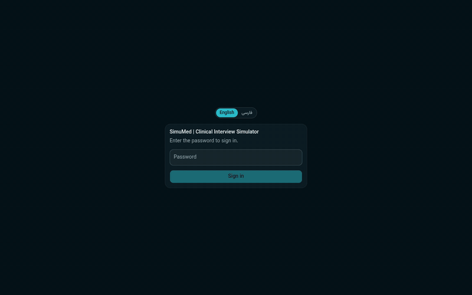

# SimuMed

**SimuMed** is a clinical-interview simulator for medical students: an
LLM-driven virtual patient in an emergency-department triage scenario. You
play the doctor — take a focused history from a dyspneic patient, examine him,
order investigations, and make the management call, then get a scored review
of your interview.

> **Draft note:** wording pending final review before the repo goes public.

## What it does

The app simulates the first minutes of an ED encounter — patient arrival, nurse
handover, history taking, examination, investigations, and the management
decision. An LLM plays the patient, the triage nurse, and the senior resident,
under a strict JSON contract (`app/lib/simumed/llm-contract.ts`) that maps what
you say to in-scenario effects (starting oxygen, ordering labs/ECG/CXR,
prescribing, ICU escalation). A scored review at the end grades the interview:
error counts by severity, domain scores, clinical-readiness (CRS) components,
performance under pressure, communication, and resilience feedback.

The teaching case — a fictional 68-year-old retired welder with a COPD
exacerbation and community-acquired pneumonia — is deterministic teaching
content: every symptom, exam finding, and lab value is fixed and clinically
grounded. The case spec lives in `app/lib/simumed/CASE.md` (Persian) and
`app/lib/simumed/copd-case.ts` / `copd-case-en.ts`.

## Features

- **Bilingual English / Persian.** Every UI string, the whole case content, and
  the LLM layer (patient, nurse, resident, hints, review) follow the active
  locale. One-click switcher, no reload, preference persisted, full RTL/LTR
  layout with Persian digits in `fa` and Latin digits in `en`.
- **Contract-checked LLM brain.** Replies are validated against a strict JSON
  contract; invalid output falls back to deterministic in-character responses,
  so the session never crashes on a model slip.
- **Scored review.** Critical/major/minor error classification, domain bars,
  CRS components, stress/diagnostic/communication scores, resilience notes, and
  a printable formal report.
- **PWA.** Installable, offline-capable shell via a service worker, install
  banner, localized manifest.

## Stack

- [Next.js](https://nextjs.org) (App Router) + React 19 + Tailwind CSS 4 +
  shadcn/ui
- TypeScript (strict), ESLint 9
- OpenAI-compatible LLM access (pluggable presets, env-driven)
- No database: session state lives in the browser; auth is a shared-password
  gate with a signed cookie and login rate limiting.

## Run locally

```bash
cd app
npm install
npm run dev
```

Open http://localhost:3000 and sign in with the app password.

### Environment variables

Create `app/.env.local` (never committed):

| Variable | Required | Purpose |
| --- | --- | --- |
| `SIMUMED_APP_PASSWORD` | yes in production | Shared password for the login gate. If unset, the gate fails open (development only). |
| `SIMUMED_LLM_API_KEY` | for the live patient | API key for the OpenAI-compatible provider. Without it, the UI runs on deterministic fallback replies. |
| `SIMUMED_LLM_PRESET` | no | `avalai` (default), `openai`, or `gemini`. |
| `SIMUMED_LLM_BASE_URL` | no | Overrides the preset base URL. |
| `SIMUMED_LLM_MODEL` | no | Overrides the preset model. |

Keys are read from the environment only; no secret is stored in the repo.

## Deployment

No deployments are currently maintained. The app builds to a standalone Node
server (`output: "standalone"`), so it runs anywhere Node does:

```bash
cd app
npm run build
node .next/standalone/app/server.js
```

Nothing ships automatically — there is no CI deploy.

## Status

Single teaching case, single-purpose app, feature-frozen polish state. The
case content is fictional; nothing here is medical advice or a real clinical
record.

## Demo



## License

[MIT](LICENSE) — Hesam Sadeghi
